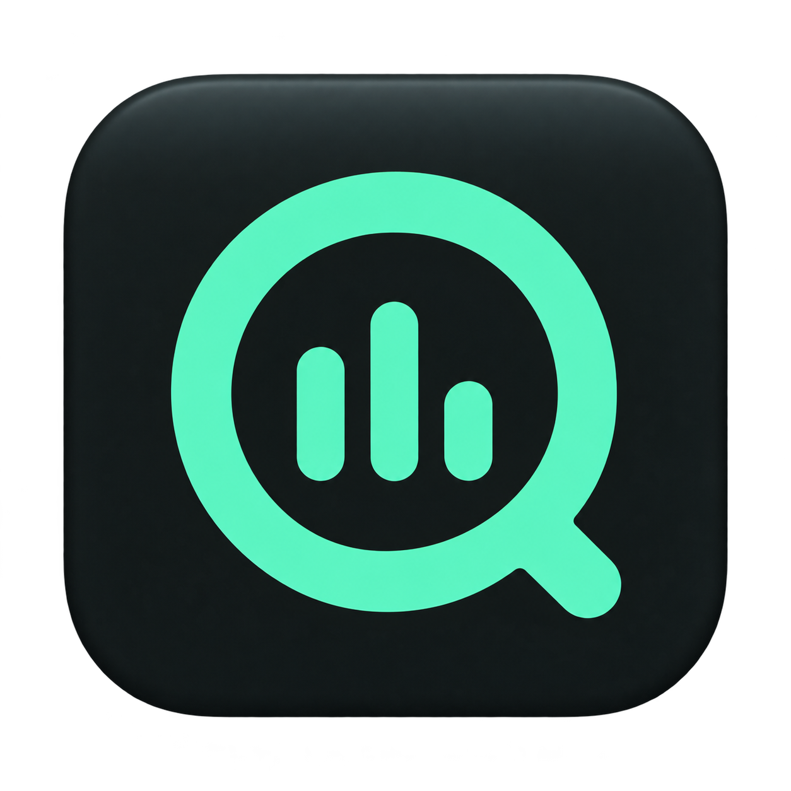
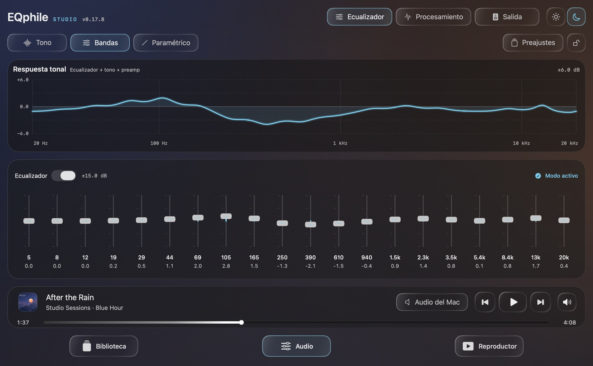
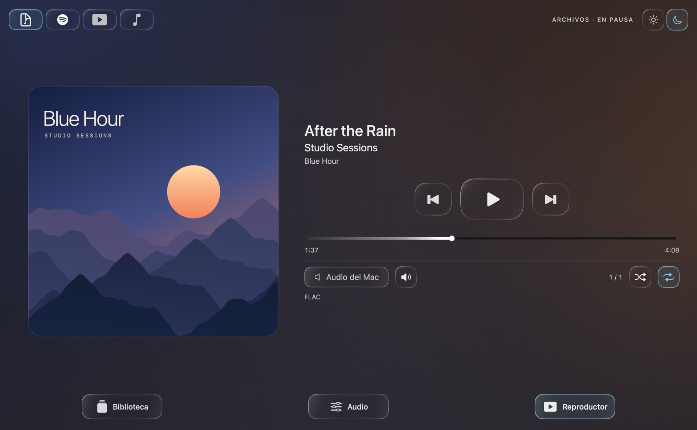
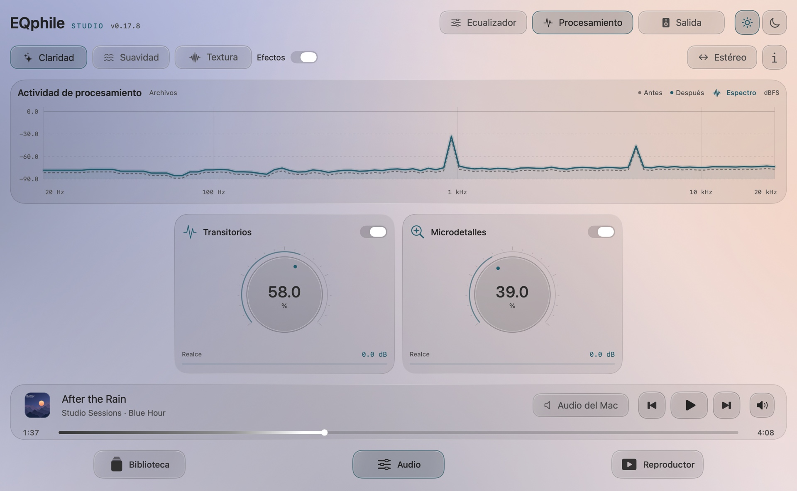
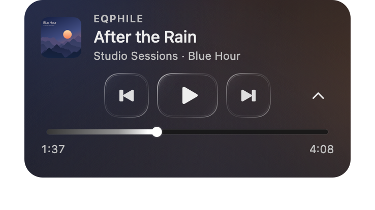

# EQphile Studio

**Un ecualizador gratuito para el audio de todo tu Mac con Apple Silicon.**

Activa **Audio del Mac** para aplicar tu ecualización y tus efectos al sonido de apps como Spotify, Música y el navegador. Ajusta 20 bandas gráficas, una banda paramétrica, el tono y cinco efectos independientes. EQphile Studio también reproduce tus archivos y lleva los controles de reproducción a la parte superior de la pantalla con **EQphile Notch**.

**[Descargar la beta 0.17.8](https://github.com/gmaurotl/EQphileStudio/releases/tag/v0.17.8)** · [Instalación](INSTALLATION.es.md) · [English](README.md)

## Ajusta el sonido

- **Ecualizador.** Ajusta 20 bandas gráficas, una banda paramétrica, graves, agudos y preamplificación. Observa cómo cambia la respuesta tonal al mover los controles.
- **Procesamiento.** Ajusta el desenmascarado espectral, la definición de transitorios, la textura armónica, la suavidad dinámica y los microdetalles. Cada efecto tiene su propio interruptor y control de intensidad.
- **Audio del Mac.** Actívalo para aplicar tus ajustes al sonido de otras apps del Mac. macOS pide permiso para acceder al audio del sistema. Los formatos de salida dependen de tu dispositivo de audio.

## Ten tu música a mano

- **Archivos locales.** Reproduce archivos compatibles FLAC, WAV, AIFF, MP3 y AAC con los datos de la pista y la carátula cuando estén disponibles.
- **Apple Music, Spotify y YouTube.** Consulta qué suena en Música para Mac, Spotify de escritorio o un navegador compatible. Las carátulas y los controles dependen de la fuente. Los controles de Spotify y Música requieren el permiso de Automatización de macOS.
- **EQphile Notch.** Accede a la carátula y a los controles de reproducción disponibles desde el panel opcional de la parte superior de la pantalla.
- **Apariencia.** Elige el tema claro u oscuro y un color de acento. La carátula tiñe la interfaz de cristal. Disponible en español, inglés, francés y alemán.

## Capturas

### Reproductor de música

### Procesamiento

### EQphile Notch

Las capturas usan datos de una pista de demostración y una carátula original. La gráfica de procesamiento usa una señal de prueba.

## Instala y actualiza

1. Descarga **`EQphileStudio-0.17.8-arm64.zip`** desde [GitHub Releases](https://github.com/gmaurotl/EQphileStudio/releases/tag/v0.17.8). Encontrarás el ZIP de la app en **Assets**.
2. Descomprime el ZIP y mueve **EQphile Studio** a **Aplicaciones**. La beta lleva firma ad hoc y se distribuye sin notarización de Apple. Si macOS bloquea la primera apertura, sigue la [guía de instalación](INSTALLATION.es.md).
3. Consulta [Releases](https://github.com/gmaurotl/EQphileStudio/releases) para descargar e instalar manualmente las actualizaciones.

Esta beta es para **Apple Silicon**. Se probó en **macOS 27.0.1** y su destino técnico es **macOS 14.2** o posterior. Consulta [Compatibilidad](COMPATIBILITY.es.md) para ver el alcance de las pruebas y los límites de los archivos.

## Soporte y proyecto

Informa de un problema en [Issues](https://github.com/gmaurotl/EQphileStudio/issues/new/choose) o escribe a [eqphile@maurotarazona.com](mailto:eqphile@maurotarazona.com) para recibir soporte en privado. Desarrollado por Mauro Gonzalo Tarazona-Levano. [Web del desarrollador](https://maurotarazona.com)

EQphile Studio es gratuita. Este repositorio aloja las descargas y la documentación. El código de la app es privado. Si te apetece apoyar el desarrollo, puedes [invitarme a un café](DONATIONS.md).

[Guía de soporte](SUPPORT.md) · [Privacidad](PRIVACY.md) · [Condiciones de uso](LICENSE.txt) · [Avisos de terceros](NOTICE.md)
