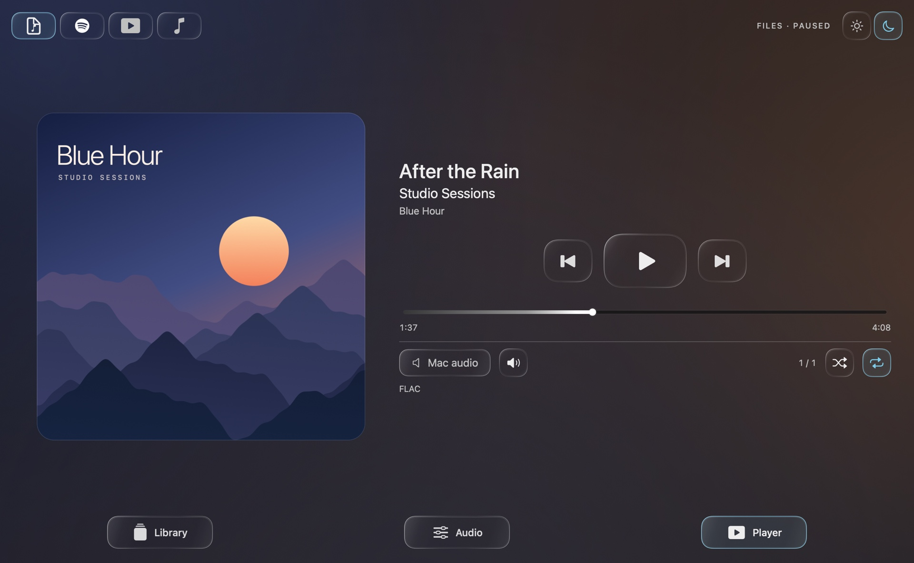

# EQphile Studio

**A free system-wide audio equalizer for Apple Silicon Macs.**

Turn on **Mac Audio** to apply your EQ and effects to Spotify, Music, your browser and other apps.

**[Download 0.17.8 beta](https://github.com/gmaurotl/EQphileStudio/releases/tag/v0.17.8)** · [Installation](docs/INSTALLATION.md)

## Shape your sound

- **Equalizer.** Adjust 20 graphic bands, a parametric band, bass, treble and preamp. See how your settings change the tonal response.
- **Processing.** Adjust spectral unmasking, transient definition, harmonic texture, dynamic smoothness and microdetail. Each processor has its own switch and intensity control.

## Keep your music within reach

- **Local files.** Play supported FLAC, WAV, AIFF, MP3 and AAC files with track information and artwork when available.
- **Apple Music, Spotify and YouTube.** See what's playing in Music for Mac, Spotify desktop or a supported browser. Artwork and playback controls depend on the source and what it makes available. Spotify and Music controls require macOS Automation permission.
- **EQphile Notch.** Bring available playback controls and artwork to the top of the screen with the optional panel.
- **Appearance.** Choose light or dark mode and an accent colour. The artwork tints the glass interface. Available in English, Spanish, French and German.

## Screenshots

### Music player

### Processing

### EQphile Notch

Screenshots show demo track information and original cover artwork. The processing graph uses a test signal.

## Compatibility

The beta was tested on **macOS 27.0.1**. See [compatibility details](docs/COMPATIBILITY.md) for the technical requirements and [installation](docs/INSTALLATION.md) for the first launch and manual updates.

## Support and project

Report a bug in [Issues](https://github.com/gmaurotl/EQphileStudio/issues/new/choose) or contact [eqphile@maurotarazona.com](mailto:eqphile@maurotarazona.com) for private support. Developed by Mauro Gonzalo Tarazona-Levano. [Developer website](https://maurotarazona.com)

The app’s source code is private. If you'd like to support development, you can [leave a tip](docs/DONATIONS.md).

[Support guide](docs/SUPPORT.md) · [Privacy](docs/PRIVACY.md) · [App terms](LICENSE.txt) · [Third-party notices](docs/NOTICE.md)
