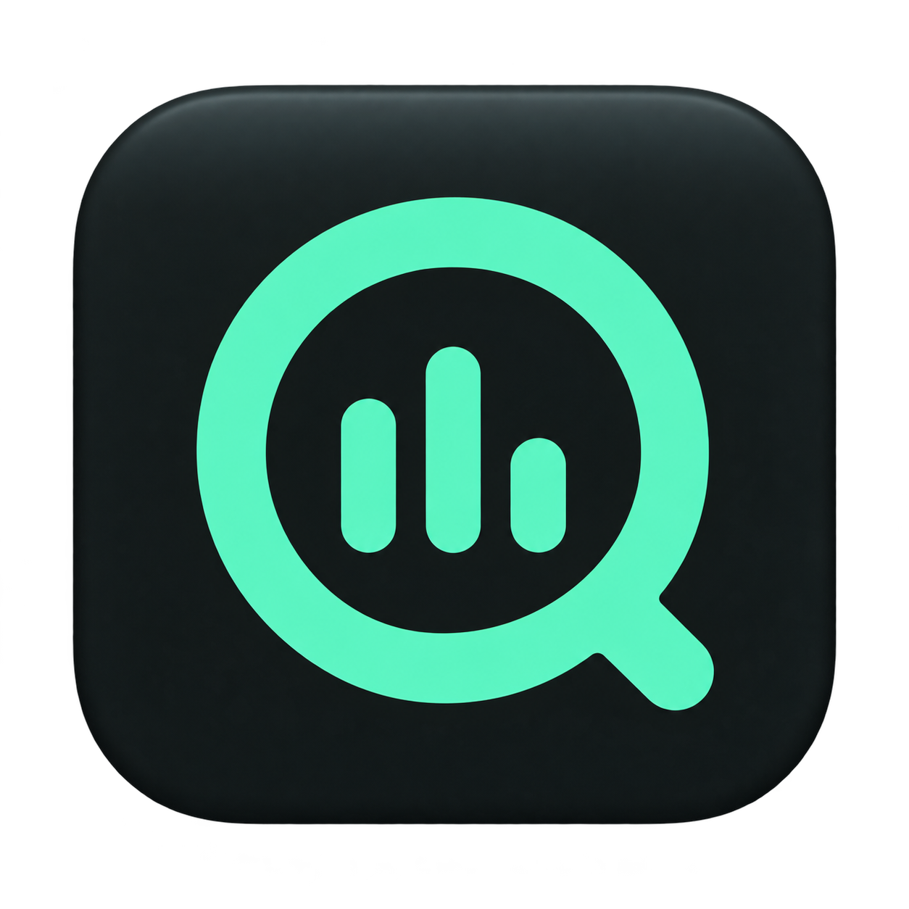
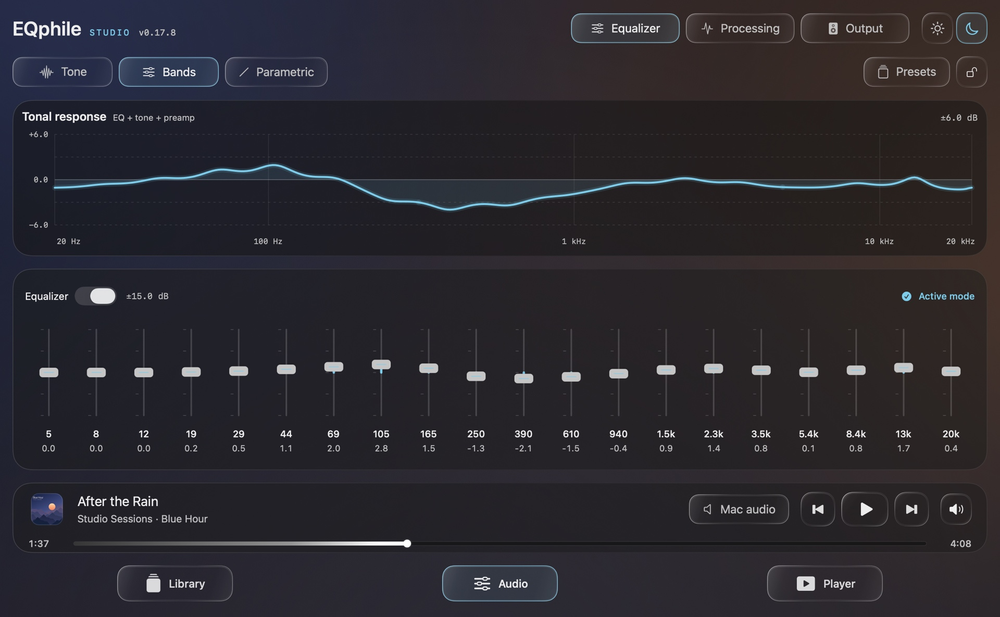
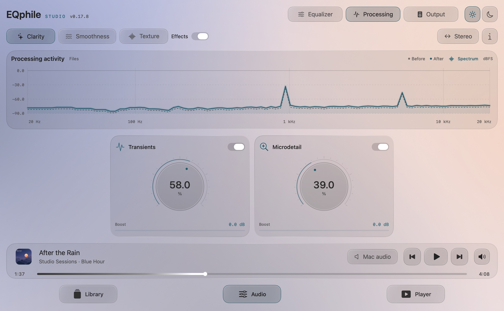
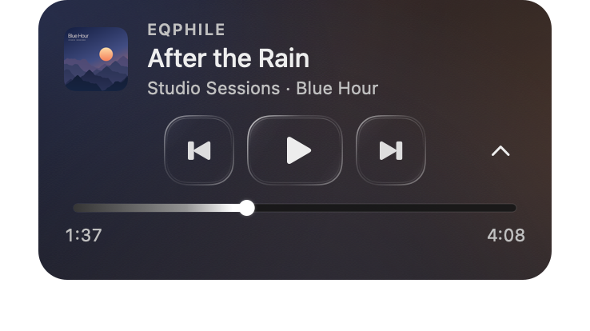

# EQphile Studio

**A free system-wide audio equalizer for Apple Silicon Macs.**

Turn on **Mac Audio** to apply your EQ and effects to the sound from apps such as Spotify, Music and your browser. Shape the mix with 20 graphic bands, parametric EQ, tone controls and five independent processors. EQphile Studio also plays local music and puts playback controls at the top of your screen with **EQphile Notch**.

**[Download 0.17.8 beta](https://github.com/gmaurotl/EQphileStudio/releases/tag/v0.17.8)** · [Installation](INSTALLATION.md) · [Español](README.es.md)

## Shape your sound

- **Equalizer.** Adjust 20 graphic bands, a parametric band, bass, treble and preamp. See how your settings change the tonal response.
- **Processing.** Adjust spectral unmasking, transient definition, harmonic texture, dynamic smoothness and microdetail. Each processor has its own switch and intensity control.
- **Mac Audio.** Enable it to apply your settings to audio from other Mac apps. macOS asks for system-audio permission. Output formats depend on your audio device.

## Keep your music within reach

- **Local files.** Play supported FLAC, WAV, AIFF, MP3 and AAC files with track information and artwork when available.
- **Apple Music, Spotify and YouTube.** See what's playing in Music for Mac, Spotify desktop or a supported browser. Artwork and playback controls depend on the source and what it makes available. Spotify and Music controls require macOS Automation permission.
- **EQphile Notch.** Bring available playback controls and artwork to the top of the screen with the optional panel.
- **Appearance.** Choose light or dark mode and an accent colour. The artwork tints the glass interface. Available in English, Spanish, French and German.

## Screenshots

### Music player

### Processing

### EQphile Notch

Screenshots show demo track information and original cover artwork. The processing graph uses a test signal.

## Install and update

1. Download **`EQphileStudio-0.17.8-arm64.zip`** from [GitHub Releases](https://github.com/gmaurotl/EQphileStudio/releases/tag/v0.17.8). Look for the app ZIP under **Assets**.
2. Unzip it and move **EQphile Studio** to **Applications**. This beta is ad hoc signed and has no Apple notarization. If macOS blocks the first launch, follow the [installation guide](INSTALLATION.md).
3. Check [Releases](https://github.com/gmaurotl/EQphileStudio/releases) for updates and install them manually.

This beta is for **Apple Silicon**. It was tested on **macOS 27.0.1** and targets **macOS 14.2** or later. See [Compatibility](COMPATIBILITY.md) for the tested scope and file limits.

## Support and project

Report a bug in [Issues](https://github.com/gmaurotl/EQphileStudio/issues/new/choose) or contact [eqphile@maurotarazona.com](mailto:eqphile@maurotarazona.com) for private support. Developed by Mauro Gonzalo Tarazona-Levano. [Developer website](https://maurotarazona.com)

EQphile Studio is free to download and use. This repository hosts the downloads and documentation. The app's source code is private. If you'd like to support development, you can [leave a tip](DONATIONS.md).

[Support guide](SUPPORT.md) · [Privacy](PRIVACY.md) · [App terms](LICENSE.txt) · [Third-party notices](NOTICE.md)
